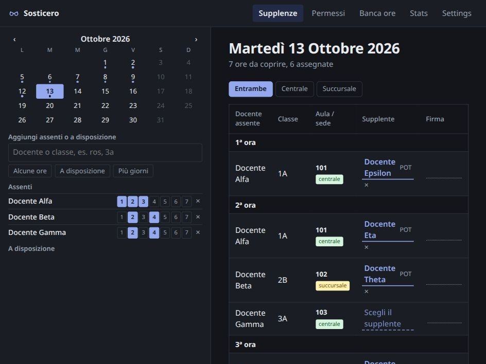
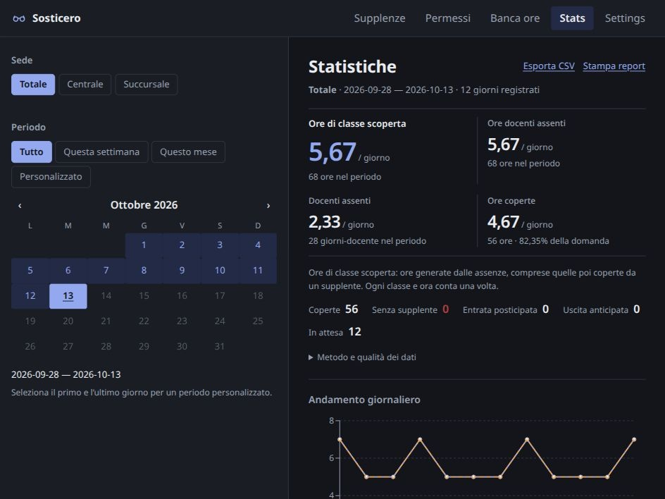

#  Sosticero

Sosticero is a web app for managing teacher substitutions, short leave and recovery hours in an Italian school. It supports two campuses (Centrale and Succursale), Monday–Friday timetables and up to seven periods a day. The interface is in Italian.

The operational installation runs on **atlante**. Server data is authoritative; the former local operational installation must remain stopped. Development uses isolated test databases.

> This project was vibecoded and reflects one school's workflow. Substitution recommendations, campus transfers and exceptional assignments require human review.

## Screenshots

These screenshots use fictional teachers and records from an isolated demo database; they illustrate the planner and statistics, rather than every current screen.





## Main workflows

### Supplenze

Select a date and record teacher absences, absent classes or manual availability. Absences can cover whole days or individual periods, with planned/last-minute classification, notes and optional PNG/JPEG attachments. Dated permits appear automatically as locked absences; prolonged absences are managed in administration.

Cover requirements are grouped by period and campus. Ranked candidates show timetable context, subject, availability and workload. Ordinary availability, permit recovery and paid substitutions have distinct accounting. Absent teachers and teachers already assigned elsewhere are blocked; exceptional choices require confirmation. A blank timetable slot does not automatically make a teacher available.

Record a substitute, an explicitly uncovered period, or late entry/early exit where permitted. Saved assignments that become inconsistent remain visible for review. Communication, acceptance and notification controls track follow-up; cross-campus availability assignments also support grouped communication.

Generate the daily substitution sheet as an A3 portrait PDF for either campus or both. **Orari** also exports a complete A4 landscape timetable PDF.

### Permessi

Record dated short leave, its selected periods, request date, classification, notes and optional attachment. The advisory daily limit is half the teacher's scheduled periods, rounded down; warnings do not prevent saving.

Recovery assignments (**RP**) reduce eligible outstanding debt. Dated permits expire after **two calendar months**, clamped to the target month's last day. Recovery before the permit date is supported subject to eligibility checks. Manual balances without a date represent earlier outstanding hours and have no automatic expiry. Timetable commitments, receptions and campus travel affect eligibility.

### Orari and receptions

Browse teacher timetables at a selected date, including lessons, activities, rooms, campuses, co-teachers and receptions. Search by teacher name or code.

Administrators import complete JSON timetables with an effective date and review the impact before confirmation. Versions preserve earlier timetable periods. Teacher IDs must remain stable across imports. Removed teachers remain historical references.

Operators can move, swap or disable eligible special hours through dated overrides, with a preview of affected assignments. Imported lessons remain intact. Overrides incompatible with a later import require review rather than silently changing saved substitutions.

Reception schedules are imported separately from XLSX, with teacher matching, optional locations and an effective date. Receptions block their numbered period from permit recovery; unknown locations require review.

### Banca ore

Manage recurring paid availability by teacher, weekday and period. Paid assignments appear in a detailed register with per-teacher totals. Administrators can configure campus budgets, hourly rates and teacher economic classifications. Budget overruns warn without preventing assignment; missing rates leave amounts to be valued.

See [Paid substitutions](docs/paid-substitutions.md) for availability and assignment rules, and [Banca ore data and budgets](docs/banca-ore-data.md) for current budget calculations and attribution.

### Statistiche

Historical analysis includes absence and cover demand, outcomes, daily trends, weekday/period comparisons and a heatmap. Separate tabs show theoretical weekly availability and class/teacher summaries. Filters, CSV export and print preview support review. Long tables show 10 rows initially and in print; CSV retains all rows. Custom ranges can include recorded future data, which is an estimate and may change.

Historical totals distinguish absent teachers, teacher-hours and class-periods needing cover. Averages use days with recorded absences or permits. Weekly availability is theoretical capacity, not a count of teachers still free after daily absences and bookings; potential recovery opportunities may represent alternative uses of the same debt.

### Inbox and publication

An optional Google Forms/Sheets integration imports absence communications for an operator to accept or ignore. Unmatched names require explicit selection; acceptance records the responsible account. Google credentials remain on the server and outside source and school-data archives.

The staff-room display is available at `/display?campus=centrale` or `/display?campus=succursale`. It is readable without login by anyone who can reach the host, so deployment access matters. Optional Cloudflare Pages publication provides explicit snapshots, including scheduled publication.

See [Staff-room display](docs/substitution-display.md) and [Public publication](docs/display-publication.md).

## Accounts and administration

Office accounts use individual usernames and passwords. Administrator privileges and substitution permissions for each campus are independent. An administrator without operational permissions does not automatically gain operational access. The protected administrator cannot be disabled or stripped of administrator status.

- **Amministrazione → Amministrazione account:** account names, passwords, roles and enabled status.
- **Amministrazione → Configurazione:** timetable/reception imports, substitution rules, paid budgets, integrations, publication, archives and backups.
- **Amministrazione → Gestione docenti:** teacher identities, staffing, prolonged absences and personal portal access.
- **Impostazioni:** personal appearance and build information.

The separate teacher portal at `/docenti` uses institutional email identifiers and generated PINs. It grants access to the teacher's own timetable, without office privileges. See [Teacher management and access](docs/gestione-docenti.md).

Office passwords use Argon2id. Sessions expire after twelve hours, and unsafe requests require CSRF protection. Shared screens refresh quietly and reject stale writes instead of silently overwriting another user's changes. Conflicting forms retain their inputs for explicit reconciliation.

## Deployment

Running a separate instance requires the copyright holder's written permission; these instructions do not grant it. See [LICENSE.md](LICENSE.md).

### Existing production server

From this checkout, deploy authorised updates with:

```sh
./scripts/deploy.sh
```

The script transfers source, builds on atlante, creates a recovery snapshot, replaces only Sosticero and verifies the deployed release. It does not upload local operational data. Committing or pushing does not deploy the application. See [Server deployment](docs/server-deployment.md) for configuration, recovery and read-only verification.

Do not restart the former local operational app to demonstrate a change. Documentation and Git-history maintenance do not require restarting production.

### Authorised standalone installations

The repository includes a Podman configuration, a Docker image build and a Windows packaging workflow. These are deployment options for authorised installations, not development-test environments. Review account initialization, persistent storage and HTTPS configuration before use.

The Windows workflow builds a `Sosticero_<date>.exe` artifact. It stores data beside the executable, so use a writable personal folder outside `Program Files`. Closing its console stops the service. The launcher prefers port 8000 and chooses another localhost port if needed.

For native builds, use Python 3.12+, Node.js 24 and the declared dependencies. Build the frontend with `npm --prefix frontend ci` followed by `npm --prefix frontend run build`. The backend starts through Uvicorn factory mode (`backend.main:create_app --factory`) and requires an explicit `DATABASE_PATH`.

New authorised production installations must initialize an administrator before startup. With backend dependencies installed, the account CLI prompts for the password without putting it in command arguments:

```sh
.venv/bin/python -m backend.auth --database /path/to/auth.sqlite bootstrap admin --name Amministratore
```

For the Windows executable, use its `--accounts` entry point. Existing installations retain their accounts. Remote access requires the correct trusted HTTPS `APP_ORIGIN`; do not expose a plain HTTP login publicly.

## Data, imports and backups

The operational database is `supplenze.sqlite`; identities and sessions are stored separately in `auth.sqlite`. Containers use `/data`, mounted from an installation-owned directory. The Windows executable uses a `data` directory beside itself.

Timetable imports accept a JSON object with `docenti` and `orario`. A minimal fictional example:

```json
{
  "docenti": [
    {"id": "teacher-1", "nome_originale": "Docente Esempio", "ruolo": "curricolare", "classe_concorso": "A026"}
  ],
  "orario": [
    {"docente": "teacher-1", "giorno": "lun", "ora": 1, "classi": ["1A"], "sede": "centrale", "aula": "101"}
  ]
}
```

Days are `lun`, `mar`, `mer`, `gio`, `ven`; periods are 1–7. Campuses are `centrale` or `succursale`; omit an unknown campus. Teacher IDs are unique and stable, and each teacher/day/period combination occurs once. List multiple classes in the same entry where necessary. Teaching timetable import uses JSON; the separate reception importer accepts XLSX.

Portable school-data archives and database snapshots preserve operational records, including attachments. They do **not** replace a protected backup of accounts, integration credentials and the complete installation. Restoring school data preserves installed accounts and invalidates sessions. Restores and global imports require review and can replace current records; do not treat them as merge operations.

Automatic startup backups are enabled by default. Never copy a live SQLite file directly: use SQLite's online backup API, or a coordinated stopped-installation procedure. Never transfer development data back into production.

| Environment variable | Purpose |
| --- | --- |
| `DATABASE_PATH` | Required explicit operational database path; container image sets `/data/supplenze.sqlite` |
| `AUTH_DATABASE_PATH` | Identity store; defaults to `auth.sqlite` beside the operational database |
| `APP_ENV` | `production` for authorised operational installations; isolated tests use `testing` |
| `APP_ORIGIN` | Trusted HTTPS origin for remote deployments |
| `BACKUP_DIR` | Defaults to `backups/` beside the operational database |
| `BACKUP_ON_STARTUP` | Defaults to `true` |
| `BACKUP_RETENTION_DAYS` | Defaults to `7` |
| `BACKUP_RETENTION_COUNT` | Defaults to `10` |
| `TIMETABLE_PATH` | Optional JSON seed for a new database |
| `STATIC_PATH` | Built frontend directory; defaults to `frontend/dist` |

## Development and verification

React, TypeScript and Vite provide the frontend; FastAPI and SQLite provide the backend. Read [AGENTS.md](AGENTS.md) before working on deployment or data. API details are in [docs/api.md](docs/api.md); planning artifacts and behavior specifications are under [openspec/](openspec/).

After installing backend and frontend dependencies, run regression tests against a temporary database:

```sh
.venv/bin/pip install httpx==0.28.1
APP_ENV=testing DATABASE_PATH="$(mktemp -d)/tests.sqlite" BACKUP_ON_STARTUP=false \
  .venv/bin/python -m unittest discover -s backend/tests
npm --prefix frontend test
```

For local container and browser checks, use only the standalone testing Compose file:

```sh
export TEST_DATA_DIR=$(mktemp -d /tmp/sosticero-test-XXXXXX)
export TEST_PROJECT="sosticero-test-$(basename "$TEST_DATA_DIR" | tr '[:upper:]' '[:lower:]')"
LOCAL_UID=$(id -u) LOCAL_GID=$(id -g) podman compose -p "$TEST_PROJECT" -f compose.testing.yaml up -d --build --force-recreate
podman compose -p "$TEST_PROJECT" -f compose.testing.yaml port app 8000
```

Inspect that project's container mount to confirm `/data` uses `$TEST_DATA_DIR`. Before changing data, verify `/api/environment` returns `{"testing":true}` and the UI shows the red **TESTING** ribbon. Use the allocated localhost port, never operational port 8000. Testing mode refuses operational data marked `.sosticero-production`; never remove that marker to bypass protection.

Stop only your own project after verification:

```sh
podman compose -p "$TEST_PROJECT" -f compose.testing.yaml down
```

Do not combine testing Compose with `compose.yaml`, create an automatic override, or leave a test database as the default deployment.

## Licence

Copyright © 2026 fabfabretti. **Proprietary software; all rights reserved.** Running a separate instance requires express written permission from the copyright holder. Authorised use of the hosted service is permitted. Third-party components retain their respective licences. See [LICENSE.md](LICENSE.md).

### Rifiuti delle supplenze

Per recuperi permesso (RP), supplenze a pagamento e cambi sede delle ore a disposizione,
**Rifiutata** registra il docente e libera la supplenza. Per un cambio sede raggruppato,
**Rifiutata (tutte le ore)** libera tutte le ore della comunicazione. La nota rossa
«Ha già rifiutato: …» rimane sotto la scelta del supplente anche dopo una nuova
assegnazione o un ricaricamento. Il docente può essere assegnato di nuovo se cambia
risposta: il rifiuto precedente resta storico, mentre Comunicato e Accettata ripartono
vuoti. Le ore rifiutate non consumano recuperi o budget a pagamento.

La cronologia segue data e identificativo della riga, non l'assegnazione. Se una riga
scompare, la cronologia rimane conservata; ricompare con la stessa identità, ma non
viene trasferita automaticamente a righe diverse quando cambiano i raggruppamenti.
Le note sono interne alla tabella operativa e non compaiono nel tabellone pubblico.
Gli archivi portabili **schema 12** conservano i rifiuti; gli schemi 1–11 restano
importabili e iniziano senza cronologia. Per ripristinare archivi schema 12 serve una
versione aggiornata dell'app. I backup SQLite conservano anche questa cronologia.

### Ore con gruppi di alunni

In **Orari → Ore con gruppi di alunni** si gestiscono impegni settimanali con docente, sede, aula,
classi di provenienza e numerosità facoltative. Ogni gruppo ha una decorrenza e
un’eventuale fine inclusiva. Le classi restano etichette di provenienza: non
creano compresenze o domanda di supplenza per l’intera classe. Il docente è
occupato anche quando le classi di provenienza sono in uscita. Le sovrapposizioni
con lezioni o ricevimenti sono conservate e segnalate.

L’assenza del docente genera una sola attività **Da valutare**, separata dalle
supplenze ordinarie: la segreteria decide come gestire il gruppo. L’ora di assenza
si conta una sola volta; sede, aula e provenienze storiche sono conservate.
L’archivio schema 13 include `studentGroupHours`; gli archivi precedenti non
cancellano i gruppi esistenti. Il salvataggio usa revisione e generazione dei dati,
rispetta le sedi autorizzate e crea un backup prima della modifica.
