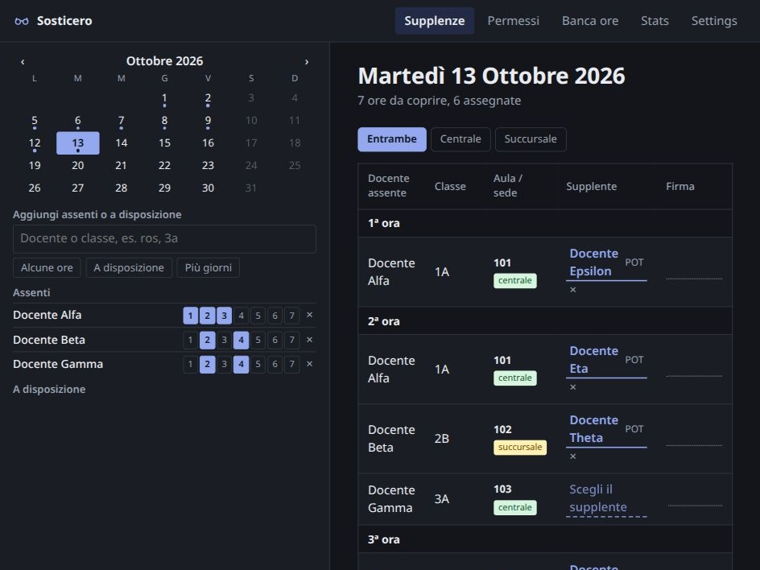
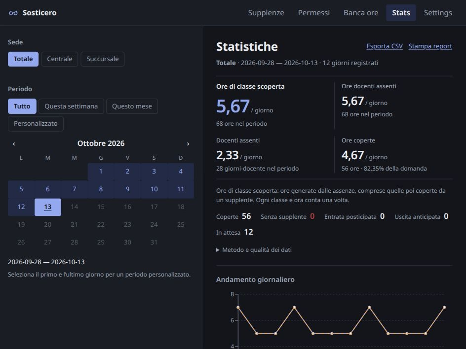

#  Sosticero

A local web app for planning teacher substitutions, tracking short leave and recovery hours, and understanding where cover is needed. Built for an Italian school with two campuses, a Monday–Friday timetable, and up to seven periods a day. The interface is in Italian. My desperation is Italian as well.

> [!NOTE]
> **This project was vibecoded.** It also contains some fixes specific to this school, at the moment. I hope to be able to generalize this once my desperation will slow down. Thank you for your time.

## Screenshots

Dark mode, using fictional teachers and records created in an isolated demo database.

**Daily substitution planner**



**Statistics and coverage**



## What you can do

### Import teacher receptions

In **Settings → Ricevimenti**, choose an XLSX file and its effective date, then generate a preview. Required columns are `docente`, `giorno` (Lun–Ven), and `ora` (1–7); optional `orario` and `luogo` retain the original details. Booking counts and class lists are ignored. Files are limited to 6 MB and 2000 rows.

Unique full-name matches are selected automatically, including configured teacher names. Search and select a teacher for uncertain matches, or explicitly skip a row. Locations are optional: blank and `a distanza` remain **Da verificare**. You can confirm Centrale or Succursale manually. Generate a fresh preview after changing selections, review assignment conflicts, then confirm. Each import replaces the whole reception schedule from its effective date until the next reception version; earlier dates stay unchanged. Skipping every row creates an empty schedule for that interval.

**Orari** displays receptions as **R**, with time/location details and warnings for overlaps with lessons. Teaching timetable edits do not change receptions. A reception blocks its entire numbered period from RP even if its clock-time range is shorter. Adjacent free periods are favorable only when campus transfers are feasible; unknown reception locations display **Potenzialmente favorevole · sede da verificare** outside the confirmed favorable group. Existing RP assignments remain stored and linked to their permit if an import makes them require review.

Reception versions and teacher mappings are included in database backups and portable JSON archives (schema 7). Restoring an older archive restores an empty reception schedule. Reception imports never change teaching-hour totals or daily permit limits.

### Plan the school day

- Browse dates in a calendar and search for teachers or classes.
- Select a teacher, review compact options, then add with **Aggiungi** or Enter. Record a whole-day absence or select individual periods; options stay set for the next entry.
- Optionally mark absences **Programmata** or **Last minute**. The sidebar groups planned, unclassified and last-minute absences; a last-minute absence or permit takes precedence for that teacher and date.
- Record classes that are away, making their teachers available where appropriate.
- Add manual teacher availability and choose its campus.
- See the classes needing cover, grouped by period, with room and campus information.
- Filter between Centrale, Succursale, or both campuses.
- Treat several absent co-teachers in the same class and period as one cover requirement.

### Print the daily substitution sheet

At the bottom of **Supplenze → Stampa / PDF**, the current campus filter is preselected. Choose **Centrale**, **Separata** (Succursale), or **Entrambe**, then select **Genera PDF**. Download the file or open it to print at **A3 portrait, 100% scale**. Both campuses are included in one PDF, each starting on a new sheet.

The paper form includes periods 1–7, the Aula / sede and Tipo columns, signature space, and at least eight rows per period, always including two extra blank writing rows beyond the entries, with thicker rules between periods. Busy periods expand onto additional pages; every page of a multipage PDF has a large **PAGE X/N** indicator at both top and bottom, counted across the whole file.

Recorded absent classes and teachers tagged **In gita** appear as independent lists. The **Docenti a disposizione** section lists the same manual and automatic availability as the sidebar in one wrapping, comma-separated row per period, with names crossed out in periods where they have already been assigned cover. POT and other candidate types are not added unless they also appear in A disposizione. Records without clear campus information are marked **sede non indicata** in supplementary lists; main substitution rows without a campus produce a warning and need correction before distributing the PDF. Exporting never changes saved data, and JSON backup remains separate.

### Find and assign substitutes

Open a cover requirement to see ranked candidates, their timetable context, teaching subject, campus, and recorded substitution workload. The ranking is currently fixed, but I hope to make it flexible in the future.

Absent or already assigned teachers are blocked. Candidates at the other campus are distinguished, and occupied teachers can appear as exceptional choices when the configured rules allow them. Exceptional assignments require confirmation. A blank timetable slot alone does not make a teacher available for ordinary cover.

You can assign a substitute, record late entry or early exit at the class’s effective timetable boundary, or explicitly mark a period **Scoperta** when no substitute was found. Existing assignments that become inconsistent after an edit are flagged for review. The app suggests choices; the person planning cover makes the final decision.

### Manage short leave and recovery

The **Permessi** register records a teacher’s leave date, selected periods, and optional request date and planned/last-minute classification. Leave automatically appears as a locked absence in the substitution planner. The advisory daily limit is half the teacher’s scheduled periods, rounded down; exceeding it shows warnings but does not prevent saving. Dates use `dd/mm/yyyy`, with new leave and request dates defaulting to today.

**Saldo manuale senza data** records outstanding hours from earlier periods without creating a dated absence in the substitution planner. Enter a teacher and total hours; manual balances have no automatic expiry and show their linked recoveries and remaining hours. Dated permits are recovered first. A balance with linked recoveries cannot be deleted or reduced below the hours already recovered.

**RP — Recupero permesso** offers eligible teachers for otherwise unscheduled periods when they owe recovery hours. Each RP assignment pays back one hour from the oldest eligible permit. The register shows recovered hours, remaining debt, recovery assignments, and expired debt. The recovery window is one calendar month, inclusive, with month-end dates clamped to the last day of the following month. Adjacent lessons, gaps, and cross-campus travel restrictions affect RP eligibility. (Obviously, this is tailored to this specific school at the moment. Hope to generalize this as well).

### Read the weekly timetables

**Orari** shows one weekly grid per teacher for a selected date. Campus-coloured outlines identify class lessons; filled rectangles identify special activities, with campus-coloured C/S markers inside. Compresenza tooltips name co-teachers. Filter by name or code, then use **Modifica** to move, swap or disable special hours through dated overrides while imported timetables remain intact. See **Modifiche manuali agli orari** below.

### Understand demand and coverage

**Stats** offers totals, daily averages, trends, weekday and period comparisons, and an interactive day-by-period heatmap. Filter by campus and by all recorded dates, this week, this month, or a custom range. Export CSV or open a printable report.

Statistics distinguish absent teachers, absent teacher-periods, and class-periods needing cover. They also distinguish substitute cover, explicit uncovered outcomes, late entry, early exit, and pending decisions. Averages use **days with recorded absences or permits**, not every school day. “Ore da coprire” measures cover demand, including periods subsequently covered. The summary omits covered hours and coverage percentages because another campus may record its substitutions in a separate instance; the remaining outcome breakdown describes only local records.

### Configure and protect your records

- Import your timetable as JSON; no real timetable or school database is bundled.
- Configure each hour type’s availability, visibility among candidates, and school membership.
- Switch between light and dark themes.
- Export and import the operational archive as JSON.
- Create database backups, view available snapshots, and restore one from Settings.
- Keep automatic startup backups, with configurable retention.
- Authenticate... no, not yet. But I'll add it. Soon. I promise..... (Same for concurrent use...)

Timetable updates preserve operational records. Keep teacher IDs stable: an existing ID must continue to identify the same person. Removed teachers remain as historical references. Archive import replaces operational records; backup restore replaces the database. Back up before either operation.

## Deploy on Windows

No Python, Node, Docker, or WSL required. Download the latest `Sosticero_<date>.exe` from the repository's **Actions → Windows exe** artifacts (built automatically on every push to `main`, or manually from the Actions tab), put it in a normal folder such as `Documents\Sosticero`, and double-click it.

- Put it **outside `Program Files`** (that folder is read-only, and the app stores its data beside the exe).
- A console window opens and your browser opens **http://localhost:8000**. Closing the console stops the app.
- If Windows shows "Windows protected your PC", click **More info** → **Run anyway**; the app is unsigned.
- Everything the app saves lives in a `data` folder beside the exe, backups included. To update, replace the exe and keep that folder.

Then go to **Settings** and choose **Carica database JSON** to upload your timetable.

## Deploy on Linux

Clone this repository and run the commands below from its root. Open **http://localhost:8000**, go to **Settings**, and choose **Carica database JSON** to upload your timetable.


### Podman

Install Podman and a Compose provider (`podman-compose` or another provider supported by your distribution), then:

```sh
mkdir -p data
LOCAL_UID=$(id -u) LOCAL_GID=$(id -g) podman compose up -d --build --force-recreate
```

The supplied `compose.yaml` supports rootless Podman and SELinux. Data stays in `./data`, outside the container. To stop: `podman compose down`. To update: pull the new code and repeat the command above.

### Docker

Install Docker Engine, then:

```sh
mkdir -p data
docker build -t supplenze .
docker run -d --name supplenze --restart unless-stopped \
  --user "$(id -u):$(id -g)" \
  -e APP_ENV=production \
  -p 127.0.0.1:8000:8000 \
  -v "$PWD/data:/data:Z" \
  supplenze
```

Use `sudo` for Docker commands if your installation requires it. To update, rebuild the image, run `docker rm -f supplenze`, and repeat the `docker run` command. The mounted data directory survives container removal.

The normal `compose.yaml` uses Podman’s `userns_mode: keep-id`; Docker users running locally should use the commands above.

For the separate Docker server deployment behind Nginx Proxy Manager, see [Server deployment](docs/server-deployment.md). It uses one local deployment command to sync source and build on the server, persistent server data and reviewed SSH commands; the normal local Compose configuration stays unchanged.

### Without containers

Install Python 3.12+ with virtual environment support and Node.js 24 with npm, then:

```sh
python3 -m venv .venv
.venv/bin/pip install -r backend/requirements.txt
npm --prefix frontend ci
npm --prefix frontend run build
mkdir -p data
APP_ENV=production DATABASE_PATH="$PWD/data/supplenze.sqlite" \
  .venv/bin/uvicorn backend.main:create_app --factory --host 127.0.0.1 --port 8000
```

Keep the terminal open, or run that final command through your usual service manager. This serves the built frontend and API together. To update, install dependencies and build again, then restart the server.

## Timetable format

Upload a JSON object containing `docenti` (teachers) and `orario` (weekly timetable entries). Here is a minimal fictional example:

```json
{
  "docenti": [
    {
      "id": "teacher-1",
      "nome_originale": "Docente Esempio",
      "ruolo": "curricolare",
      "classe_concorso": "A026"
    }
  ],
  "orario": [
    {
      "docente": "teacher-1",
      "giorno": "lun",
      "ora": 1,
      "classi": ["1A"],
      "sede": "centrale",
      "aula": "101"
    }
  ]
}
```

Days are `lun`, `mar`, `mer`, `gio`, and `ven`; periods are integers from 1 to 7. Campus values are `centrale` or `succursale`; omit the field when unknown. Each teacher needs a unique, stable ID, and each teacher/day/period combination can appear only once. List multiple classes in one entry where needed. Optional `attivita_riconosciute` (an array of codes) and `attivita_originale` (text) describe timetable activities. Review imported hour types in Settings before using candidate recommendations.

There is no spreadsheet or Untis file importer: convert your timetable to this JSON structure before uploading it.

## Data and backups

The default database is **`data/supplenze.sqlite`**. Container deployments store everything under the mounted `./data` directory, including backups in `data/backups/`; the prebuilt Windows app keeps the same files in a `data` folder beside the exe. Restarting or rebuilding the container keeps these records; deleting the directory does not.

Archives include optional `absenceKinds` and `permitKinds` maps keyed by date and teacher, with values `planned` or `last_minute`. Missing entries are unclassified; existing data is not backfilled. Older archives remain importable, but editing or importing through an older app version may discard classification metadata.

An automatic backup is created at startup when none exists for that calendar day.

Optional environment variables:

| Variable | Purpose | Default |
| --- | --- | --- |
| `DATABASE_PATH` | SQLite database location | `data/supplenze.sqlite` (containers: `/data/supplenze.sqlite`) |
| `BACKUP_DIR` | Snapshot directory | `backups/` beside the database |
| `BACKUP_ON_STARTUP` | Enable startup backups | `true` |
| `BACKUP_RETENTION_DAYS` | Retention age in days | `7` |
| `BACKUP_RETENTION_COUNT` | Minimum recent snapshots to keep | `10` |
| `TIMETABLE_PATH` | Optional local JSON to seed a new database | Unset; upload through Settings |
| `STATIC_PATH` | Built frontend directory | `frontend/dist` |

Set these in your shell for a native deployment, with `-e` for Docker, or through an explicitly selected Compose configuration for Podman.

## Development and limitations

React + TypeScript + Vite frontend; FastAPI backend; SQLite storage. No cloud account or external database is required. The API documentation is available at `/docs` while the app is running.

> [!Important] The rules reflect one school’s workflow, rather than every contract or institution. Campus transfers, exceptional cover, and entry/exit decisions need human review. Dataset anomalies are shown for review; potentially duplicate people are not merged automatically. Screens refresh after edits and date changes; there is no live synchronization between browsers. Concurrent database writes are transactional, but users may need to refresh to see another person’s edits.

To run the tests after installing the dependencies above:

```sh
.venv/bin/pip install httpx==0.28.1
APP_ENV=testing DATABASE_PATH="$(mktemp -d)/tests.sqlite" BACKUP_ON_STARTUP=false \
  .venv/bin/python -m unittest discover -s backend/tests
npm --prefix frontend test
```

Always use an isolated database for development. See [AGENTS.md](AGENTS.md) for this repository’s data protection and deployment rules. Planning documents and detailed behavior specifications live under [openspec/](openspec/).

## License

Copyright © 2026 fabfabretti. Licensed under the **GNU Affero General Public License, version 3 only** (`AGPL-3.0-only`). See [LICENSE.md](LICENSE.md) for the full terms.

Optional plain-text **Note** fields are available before saving in all three creation flows: adding an absent teacher in **Supplenze**, adding a dated permit in **Permessi**, and adding a **Saldo manuale senza data**. Edit saved absence notes through **⋯**, and permit/balance notes through their edit actions. Hover or focus **(i)** beside a teacher in either Permessi table to read that record’s note; dated absence and permit notes also appear together on the daily Assenze row, labelled **Assenza** and **Permesso**. Clearing the text removes the note. Successful creation, cancellation and switching form modes clear the draft; failed saves retain it. Both Permessi tables use compact spacing and inline period warnings while keeping all columns and full recovery details.

### Isolated test deployments

Normal `podman compose up` keeps the real database on port 8000. Run browser tests
in a separate project, with a separate image, temporary data directory, and an
automatically allocated localhost port:

```sh
export TEST_DATA_DIR=$(mktemp -d /tmp/sosticero-test-XXXXXX)
export TEST_PROJECT="sosticero-test-$(basename "$TEST_DATA_DIR" | tr '[:upper:]' '[:lower:]')"
LOCAL_UID=$(id -u) LOCAL_GID=$(id -g) podman compose -p "$TEST_PROJECT" -f compose.testing.yaml up -d --build --force-recreate
podman compose -p "$TEST_PROJECT" -f compose.testing.yaml port app 8000
```

Open the printed localhost port. Verify the container's `/data` mount points at
`$TEST_DATA_DIR` and `/api/environment` returns `{"testing":true}` before testing.
Tests start with an empty database. If realistic data is needed, use SQLite's
online backup API to create a fresh copy in the test directory before startup;
never copy live SQLite files directly. Each agent must create its own directory
and project. Never combine `compose.testing.yaml` with `compose.yaml`.

Stop only your own test deployment when finished:

```sh
podman compose -p "$TEST_PROJECT" -f compose.testing.yaml down
```

A red **TESTING** corner ribbon appears on every test screen, including dialogs.
The label refreshes every 15 seconds and defaults to TESTING if the environment
cannot be verified. It identifies configuration; always verify the actual mount.
Testing mode refuses the project's operational database and any data directory
marked `.sosticero-production`. Production startup creates that marker. Keep it.
Backend imports do not open a database; startup requires an explicit database
path. Production timetable uploads require confirmation before replacement.

### Allegati immagine

Assenze docenti, permessi con data e disposizioni manuali accettano un allegato
facoltativo per registrazione: incollare uno screenshot nell'area dedicata,
controllare l'anteprima e salvare. Dalla modifica è possibile sostituirlo o
rimuoverlo. Il pulsante (i) accanto al nome apre informazioni e link all'immagine
in una nuova scheda. Assenza e permesso conservano allegati distinti.

Sono accettati PNG e JPEG non animati, massimo 5 MiB (5.242.880 byte) e
25 megapixel. PDF, saldi manuali senza data, classi assenti e disponibilità
automatiche non supportano allegati. I dati immagine sono nel database SQLite:
non occorre una directory di upload. I backup comprendono immagini e riferimenti;
la rimozione di un allegato non lo elimina dai backup già conservati.

Gli archivi esportati usano schema 3 e includono le immagini. L'app aggiornata
importa anche archivi precedenti senza allegati; versioni vecchie non importano
schema 3. Conservare un backup precedente all'aggiornamento prima di tornare a
una versione vecchia ed evitare modifiche ai dati con allegati usando codice
vecchio. Database, archivi e backup crescono con le immagini salvate.

### Cambi di orario con decorrenza

In **Settings → Orario**, selezionare il **JSON completo** (`docenti` e `orario`),
la decorrenza e **Mostra anteprima**. Il file mantiene il formato esistente: la data
si sceglie nell'app. Gli ID dei docenti devono rimanere stabili: cambiare un ID
crea un'identità distinta e non trasferisce le registrazioni.

Ogni versione vale dalla decorrenza compresa fino alla versione successiva.
Sono ammesse decorrenze passate e future; una decorrenza già occupata viene
rifiutata. Non sono previsti aggiornamenti parziali, modifiche alle versioni
salvate o ritorni automatici al vecchio orario. Il primo orario è la versione
iniziale per tutte le date precedenti alla prima versione con decorrenza.
L'aggiornamento conserva l'orario già presente come versione iniziale, ma non
può ricostruire orari sovrascritti prima dell'introduzione di questa funzione.

L'anteprima elenca lezioni cambiate, aggiunte/rimozioni di docenti, giornate
registrate coinvolte e assegnazioni da verificare. Una decorrenza nel passato
corregge intenzionalmente quelle giornate e le relative statistiche: controllare
l'intervallo prima di confermare. Le date fuori dall'intervallo non cambiano.
Un file incompleto può sembrare una rimozione intenzionale: verificare sempre
l'elenco dei docenti rimossi e che il file contenga l'intero orario scolastico.

La conferma crea prima un backup SQLite verificato. Se il backup fallisce,
l'importazione non procede. Versione, evidenze e statistiche vengono applicate
in un'unica transazione; un errore non lascia un aggiornamento parziale. Se i
dati cambiano dopo l'anteprima occorre generarne una nuova. Il nome del backup
precedente viene mostrato dopo l'importazione.

Assenze, permessi, note, immagini, disposizioni, classi fuori e assegnazioni
restano salvati. Le assegnazioni non più valide o senza una riga corrispondente
appaiono nella giornata con il contesto originale. Si possono rimuovere oppure
spostare su una riga libera: lo spostamento è validato e fallisce senza perdere
l'originale se il docente non è disponibile. Per cambiare docente su una riga
ancora presente usare il normale selettore. Le assegnazioni RP mantengono il
collegamento al permesso e il conteggio dei recuperi fino alla correzione
esplicita; una copertura RP in conflitto non conta come copertura valida nelle
statistiche. I fatti precedenti alla correzione sono conservati nella cronologia.

Gli archivi esportati usano lo schema 5 e includono orari, modifiche manuali, evidenze, statistiche
e immagini. Gli schemi precedenti restano importabili, se compatibili, senza
sostituire la cronologia già presente; il loro contesto eventualmente ricostruito
non equivale a un orario storico originale. Un ripristino da backup ripristina
l'intero database e richiede conferma: annulla anche le modifiche successive al
backup. Prima di tornare a una versione precedente del programma, ripristinare
un backup compatibile soltanto dopo aver salvato i dati correnti e autorizzato
esplicitamente il ripristino.

API: `POST /api/timetable/preview?effective=2026-10-15` riceve il JSON completo
e restituisce l'impatto con `token`. Per applicare inviare lo stesso JSON a
`POST /api/timetable?effective=2026-10-15&token=TOKEN&confirm=true`.
Una conferma scaduta restituisce 409, dati non validi o un backup fallito 422.
Il caricamento iniziale senza orario resta compatibile con il vecchio endpoint;
in servizio operativo richiede comunque `confirm=true`.

### Importazione assenze da Google Forms

In **Settings → Assenze da Google Forms**, carica il JSON dell'account di servizio,
inserisci URL/ID del foglio e nome della scheda (ad esempio `Risposte del modulo 1`),
e salva. Abilita Google Sheets API nel progetto Cloud e condividi il foglio con
l'email mostrata come **Visualizzatore**. Usa **Test connessione salvata** per
controllare l'accesso. Il test non aggiunge elementi; la sincronizzazione automatica
parte dopo il salvataggio e legge tutte le risposte, anche passate.

Ogni 30 secondi il server controlla le risposte; una notifica nella barra permette
di aprire **Inbox**, disponibile anche dal menu. Un breve suono segnala nuove
comunicazioni dopo la prima interazione con la pagina (richiesta del browser per
abilitare l’audio); il caricamento iniziale e le accettazioni non suonano. **Accetta** aggiunge solo le ore
mancanti, conservando note, classificazione e allegati, e aggiunge la nota
`imported from sheet` una sola volta per docente e data. **Ignora** lascia invariato
il calendario. I periodi di più giorni includono solo lunedì–venerdì. Le assenze
orarie non generano debiti da recuperare. I nomi non riconosciuti richiedono la
selezione manuale di un docente; dati non validi bloccano l'accettazione.

Aggiungi risposte tramite il modulo: le modifiche a vecchie righe non sono
sincronizzate come correzioni. Eliminare righe di prova prima del primo collegamento
ne evita l'importazione; dopo il caricamento occorre ignorarle in Inbox o correggere
le assenze accettate da Supplenze. Eliminare/spostare righe non duplica le altre
comunicazioni. Senza un ID del modulo, eliminare e ricreare una risposta perfettamente
identica (incluso timestamp) non è distinguibile dalla stessa risposta già vista.

La chiave è salvata in `data/keys/google-service-account.json`, con directory 0700
e file 0600, esclusa da Git, immagine container, esportazioni e backup. Non inserire
mai il JSON nel repository. Su una nuova macchina è necessario caricarlo nuovamente;
un ripristino conserva la chiave locale. I backup SQLite comprendono configurazione
e cronologia Inbox: ripristinarli può riproporre comunicazioni successive al backup.
Le esportazioni JSON delle supplenze non trasferiscono l'integrazione Inbox.
Mantieni il servizio sull'accesso localhost previsto dalla configurazione esistente.

### Modifiche manuali agli orari

In **Orari**, scegli la data di visualizzazione e premi **Modifica** sul docente.
Le lezioni mostrano classe e `C`/`S` in un rettangolo vuoto con bordo della
sede; le attività senza classi hanno il fondo della sede. Le lezioni con classi,
comprese le attività collegate a una classe, restano fisse.

Trascina un'ora speciale su una cella vuota per spostarla oppure su un'altra ora
speciale dello stesso docente per scambiarle. Durante il trascinamento una copia dell’ora segue il puntatore e la destinazione
si evidenzia, indicando spostamento o scambio. Con la tastiera usa **Alt + frecce**
sull’ora speciale. Il clic sull'ora
speciale la disabilita o riattiva. Un'ora disabilitata resta un impegno: compare
solo in **Solo in caso di necessità**, richiede la conferma eccezionale e non
crea disponibilità RP. I tipi nascosti restano nascosti, anche con disponibilità
manuale; assenza e doppia assegnazione non si possono aggirare.

**Dal** stabilisce l'inizio; **Fino al** è facoltativo e comprende l'ultimo giorno.
La modifica si ripete ogni settimana. Una modifica con inizio successivo prevale
sull'intera settimana del docente durante il proprio intervallo; quando termina,
riprende la precedente modifica ancora valida, oppure l'orario importato.
Rivedere la stessa decorrenza conserva la revisione precedente come evidenza.
Il badge **MODIFICATO · dal …** indica la decorrenza; le modifiche future sono
segnalate come programmate e consultabili in **Modifiche salvate**.

**Salva** verifica la modifica e la registra; se crea nuovi problemi in assegnazioni salvate, mostra un riepilogo compatto
con dettagli espandibili e richiede **Conferma e salva**. Le giornate senza
nuovi problemi non interrompono il salvataggio.
**Annulla** scarta la bozza. Cambiare la decorrenza ricarica l'orario relativo;
chiede conferma solo se la bozza contiene modifiche non salvate.
**Ripristina**, seguito da **Salva**, torna all'orario importato dalla data scelta senza
cambiare il passato o far riapparire modifiche precedenti dopo una scadenza.
In **Modifiche salvate**, **Elimina** rimuove la modifica scelta e tutte le sue
revisioni con la stessa decorrenza. L'orario torna alla modifica precedente ancora
valida, oppure all'originale importato. Prima di eliminare, l'app mostra le nuove
assegnazioni da verificare; le supplenze salvate restano conservate.

Le modifiche sono uno strato separato: gli originali importati restano intatti.
Un nuovo import conserva le modifiche se le ore originali coinvolte non cambiano.
Se cambia una sorgente o destinazione, l'intero spostamento/scambio viene sospeso;
le altre modifiche compatibili restano. L'anteprima di importazione mostra
compatibilità e conflitti. In Orari, **Da verificare** mostra la modifica sospesa:
ricreala sulla nuova base e salva, oppure salvala senza ricrearla per scartare la modifica sospesa.
Non viene riattivata automaticamente da import successivi. Le supplenze salvate
restano conservate e quelle non più valide vengono segnalate, senza cancellazioni,
riassegnazioni automatiche o rimborsi dei recuperi.

Gli archivi JSON di schema 5 includono modifiche, ripristini ed evidenze; gli
schemi precedenti restano accettati e conservano le modifiche presenti, mostrando
nell'anteprima di ripristino quelle incompatibili. I backup SQLite includono
l'intero strato e possono ripristinarlo insieme agli altri dati.

API: `GET /api/orari?day=YYYY-MM-DD` restituisce orario effettivo, originale,
revisioni e `basis`. `POST /api/orari/preview` riceve `{teacher, start, end,
cells, basis, reset}`: `end` può essere `null`, `cells` contiene tutte le celle
`lun|1` … `ven|7` (oggetto lezione o `null`). Il ripristino usa `reset: true` ed
`end: null`. `POST /api/orari/override` riceve lo stesso corpo con il `token`
dell'anteprima. Una base o anteprima scaduta restituisce 409 e richiede verifica.
Per eliminare una modifica, gli stessi endpoint ricevono `{delete: true, id,
teacher, start, basis}` e, al salvataggio, il `token` dell'anteprima.
`POST /api/import/preview` mostra i conflitti prima del ripristino di un archivio.

### Disponibilità sulla carta nelle statistiche

Sotto Giorno × ora, **A disposizione** usa la sede selezionata nelle statistiche
(Centrale, Succursale o entrambe) e una settimana indipendente, anche futura.
Disponibili conta le attività abilitate nell’orario effettivo e nelle modifiche
di Orari; Reperibili aggiunge le ore favorevoli per recuperare permessi con debito
ancora utilizzabile alla data. Le assenze, le supplenze assegnate e le disponibilità
inserite per la singola giornata non modificano questa capacità teorica.
Le opportunità RP sono alternative: lo stesso debito può comparire in più celle.

La percentuale POT confronta le ore abilitate **POT + ALF + PE** con il loro totale
settimanale, comprese le ore disabilitate. DI.S e RP sono esclusi dalla percentuale.
Il 40% è un riferimento atteso, non un vincolo. Per entrambe le sedi si dividono
i conteggi complessivi, senza fare la media delle percentuali delle due sedi.
Le ore senza sede sono incluse solo nel totale e segnalate separatamente.

L’endpoint di sola lettura è
`GET /api/stats/availability?date=2026-10-20&campus=total`;
`campus` accetta `centrale`, `succursale` e `total`, mentre la data omessa
usa il giorno corrente a Roma. La risposta contiene date, versioni dell’orario,
docenti per cella, conteggi POT e ore senza sede. Non salva statistiche derivate.
Il CSV storico conserva il proprio schema; la stampa include entrambe le griglie
con le date e la sede della disponibilità.


Stats weekday grids keep equal weekday widths on narrow screens. The day-by-period
selector offers demand and absent teachers; teacher-hours remain in the summary
and daily trend. Availability hover panels pass pointer input through to nearby
cells, with compact name/activity/C-S entries grouped as Disponibili and
Reperibili (RP). Click or Enter pins a long list for scrolling; Escape closes it.

### Modifiche simultanee

Supplenze e Permessi controllano gli aggiornamenti ogni 15 secondi e quando si
ritorna alla scheda del browser. Gli aggiornamenti mantengono scorrimento,
filtri e focus; durante un inserimento o un pannello aperto vengono rinviati
fino alla fine dell'interazione. Il salvataggio verifica comunque i dati attuali.
Le comunicazioni Inbox mantengono il controllo ogni 30 secondi.

Le modifiche operative inviano `expected`, una mappa dei token restituiti in
`concurrency` dalla lettura precedente. Un token mancante produce HTTP 428;
un record modificato produce HTTP 409 (`record_changed`) senza modifiche
parziali. La creazione controlla anche che il record non esista già. I token
riguardano i singoli record, non l'intero database. I client devono conservare
il riferimento visualizzato, senza rileggerlo automaticamente prima di scrivere.

In caso di conflitto, i pulsanti immediati mostrano lo stato salvato; i moduli
mantengono i valori inseriti e richiedono «Ricarica valori salvati» prima di
riprovare. Non viene ripetuta automaticamente una modifica rifiutata. Se una
comunicazione Inbox è già stata elaborata, viene indicato che le scelte del
secondo operatore non sono state applicate.

Importazioni globali e ripristini del database vanno eseguiti fuori dalle
sessioni di modifica degli operatori: il coordinamento di queste operazioni
con modifiche contemporanee non è incluso nella protezione dei singoli record.
